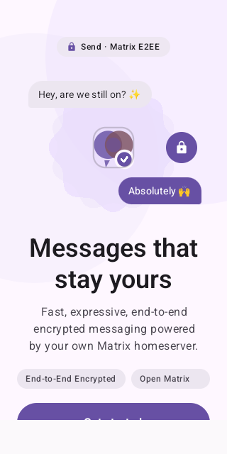
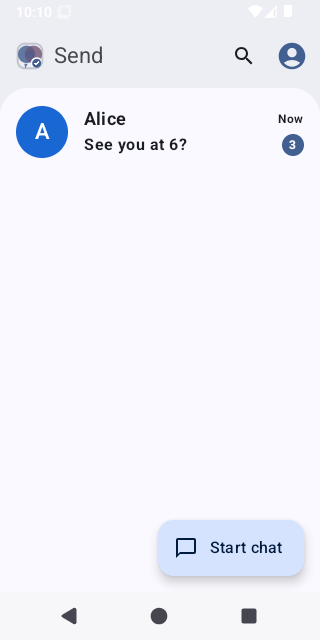
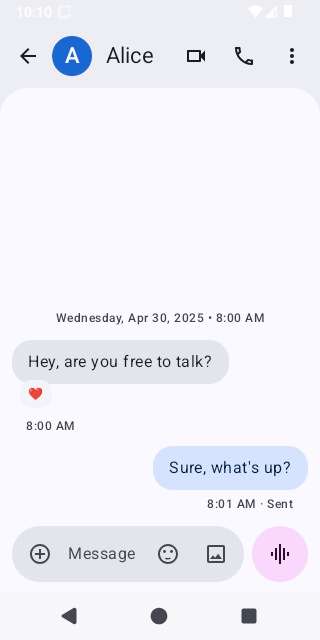
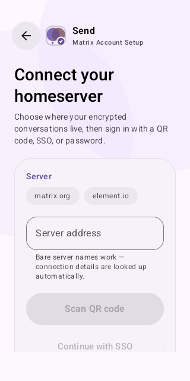
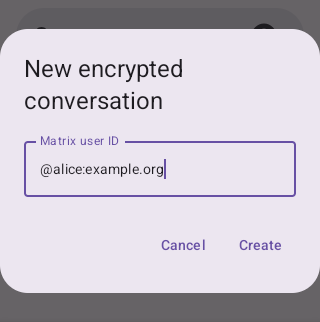
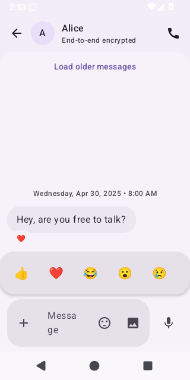
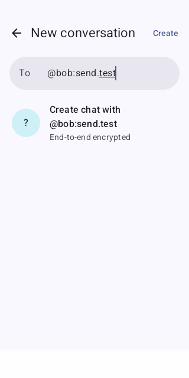
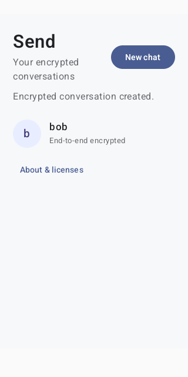
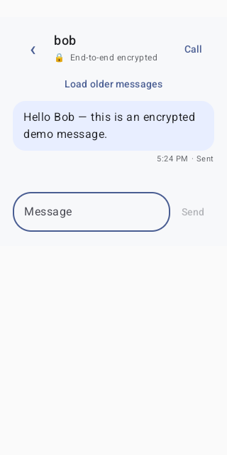

# Send

**Messages that stay yours.** Send is a standalone Android Matrix client with a
Google Messages–style Material 3 interface: expressive, fast, and end-to-end
encrypted by default. It uses the Matrix Rust SDK (Kotlin/Android binding) for
messaging and Element Call Android for native MatrixRTC audio calls. Only
end-to-end encrypted rooms can be opened for messaging.

| Onboarding hero | Conversations | Encrypted chat |
|---|---|---|
|  |  |  |

## Features

- **Pixel-style onboarding** — animated Material scallop hero with orbital chat
  bubbles and an E2EE lock badge, then a one-tap setup card.
- **No `https://` typing** — enter a bare server (`reilly.asia`), a full Matrix
  ID (`@you:reilly.asia`), or a full URL. Connection details resolve via
  `.well-known/matrix/client`, with `https://<server>` fallback.
- **Password-manager friendly** — a full Matrix ID in the username field
  supplies the server automatically.
- **Three ways in** — QR-code pairing, Single Sign-On, or username + password.
- **Google Messages look** — floating pill search with live filtering,
  deterministic pastel contact avatars, grouped chat bubbles (20 dp outer /
  4 dp touching corners), filled pill composer, horizontal reaction bar with
  overlapping reaction pills, dark-mode dynamic color.
- **Encrypted everything** — unencrypted rooms stay hidden; reactions,
  pagination, and outgoing audio calls included.
- **Messages features on Matrix** — attach files or photos/videos from the
  composer, hold the round button to record a voice message, play voice clips
  and open media inline, conversation snippets with relative times and unread
  badges cleared by read receipts, and encrypted group creation.
- **Account safety** — the account menu holds Security and Sign out: set up
  recovery (key backup, recovery key shown once), verify a new session with
  emoji from another device or with the recovery key, and see
  "Waiting for this message…" bubbles that explain why a message can't be
  decrypted yet and how to fix it. Sign out wipes the local encrypted store.

## Signing in

| Setup card | New encrypted chat | Reactions |
|---|---|---|
|  |  |  |

1. Tap **Get started** (defaults to `matrix.org`, or pick a preset chip).
2. Type any of: `reilly.asia`, `@you:reilly.asia`, `https://matrix.example.org`.
3. Sign in with a QR code, SSO, or password — then start an encrypted chat.

## Live demo (disposable Synapse)

CI spins up a local Synapse, seeds demo accounts, creates an encrypted room,
and sends a real message through the Matrix Rust SDK:

| Create chat | Demo list | Demo message |
|---|---|---|
|  |  |  |

All PNGs are captured on the Android emulator at original resolution. Full-size
sets ship with every green CI run as the `Send-UI-Screenshots` artifact.

## Build and verify

Builds and automated tests run in GitHub Actions (see
[.github/workflows/android.yml](.github/workflows/android.yml)):

- `./gradlew :app:assembleDebug :app:testDebugUnitTest :app:lintDebug`
- Emulator instrumentation against disposable Synapse: real password sign-in,
  bare-server and Matrix-ID login enablement, encrypted-room creation,
  encrypted message send, reactions, recovery setup, emoji verification of a
  second device, history restore from key backup, sign-out, and screenshot
  capture.
- Green runs upload the debug APK (`Send-debug-APK`), test results
  (`Send-Android-Test-Results`), and screenshots (`Send-UI-Screenshots`).

## Docs

- [Feature screenshot walkthrough](docs/SCREENSHOT_WALKTHROUGH.md) — automated scenarios and full-size screenshots.
- [DEVELOPMENT.md](DEVELOPMENT.md) — disposable local Synapse backend and UI workflow.
- [IMPLEMENTATION_STATUS.md](IMPLEMENTATION_STATUS.md) — implemented paths and known limits.
- [ANDROID_INTEGRATIONS.md](ANDROID_INTEGRATIONS.md) — staged native-platform backlog.
- [PRIVACY.md](PRIVACY.md) — privacy policy: what leaves the device and where it goes, what stays on it, and
  why each permission is needed. The app shows the same text under About & licenses → Privacy policy.
- [fastlane/metadata/android/en-US](fastlane/metadata/android/en-US) — store listing for F-Droid and Google
  Play (fastlane layout): title, short and full description, phone screenshots from CI, and per-release
  changelogs named `changelogs/<versionCode>.txt`.

## License

Send is licensed under the **GNU Affero General Public License v3.0 only**
(`AGPL-3.0-only`). See [LICENSE](LICENSE) for the full text.

This license was chosen because the app links Element Call Android
(`v0.1.0-rc.7`) and the Matrix Rust RTC core, which are dual-licensed
`AGPL-3.0-only OR LicenseRef-Element-Commercial` by Element Creations Ltd.;
Send is distributed under the AGPL-3.0-only option. The public repository at
<https://github.com/hanthor/send-android> is the Corresponding Source for
distributed builds. Other bundled libraries (Matrix Rust SDK, ZXing Android
Embedded, AndroidX) are Apache-2.0; see
[app/src/main/assets/THIRD_PARTY_NOTICES.txt](app/src/main/assets/THIRD_PARTY_NOTICES.txt)
and the in-app "About & licenses" dialog.
