# Send

**Messages that stay yours.** Send is an Android [Matrix](https://matrix.org)
client that looks and behaves like Google Messages — and every conversation is
end-to-end encrypted. It is built on the Matrix Rust SDK, with Element Call for
voice and video calls. Unencrypted rooms are never opened.

| Conversations | Chat | Details |
|---|---|---|
|  |  | [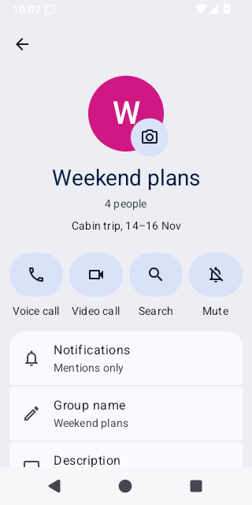](docs/screenshots/details.png) |

## Features

**Messaging**
- Text, photos, videos, files and hold-to-record voice messages (slide up to
  record hands-free), with an in-app photo/video viewer.
- Long-press for reactions and Reply, Forward, Copy, Edit, Delete, Select more
  and Info; swipe a message to reply.
- Typing dots, "Read" / "Seen by N" receipts, link previews, a full emoji
  picker and search inside a conversation.
- Encrypted direct chats and groups; star messages and find them later.

**Conversation list**
- Snippets, relative times and unread badges; search.
- Swipe to archive, long-press to select, pin, mark unread, mute, delete or
  block.

**Calls and notifications**
- Voice and video calls through Element Call (MatrixRTC), with a full-screen
  incoming-call screen, Answer/Decline and "Calling…" / "Call declined".
- Conversation notifications with inline Reply and Mark as read, delivered by
  UnifiedPush or periodic background sync; per-conversation mute.
- Share text, photos and files into Send from other apps.

**Account and security**
- Sign in with a QR code, SSO or password. Type a bare server
  (`reilly.asia`), a Matrix ID (`@you:reilly.asia`) or a URL — the server is
  found via `.well-known`, and password managers can fill the Matrix ID alone.
- Key backup with a recovery key, emoji verification of new devices,
  "Waiting for this message…" explanations for undecryptable messages, a
  device list with remote sign-out, and an encrypted on-device store.

**Look and feel**
- Google Messages layout and palette, light and dark themes, Messages-derived
  motion (screen transitions, springs, shared avatar, predictive back,
  collapsing Start chat button), two-pane layout on tablets and foldables,
  TalkBack labels and 200% font support.

## Screenshots

| Message actions | Swipe to reply | Voice message |
|---|---|---|
| [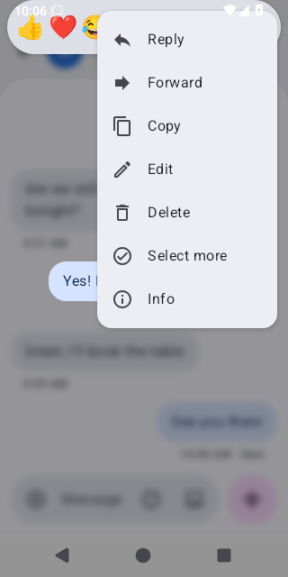](docs/screenshots/message-actions.png) | [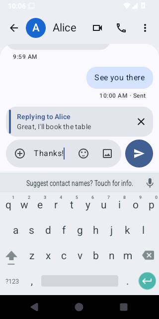](docs/screenshots/reply.png) | [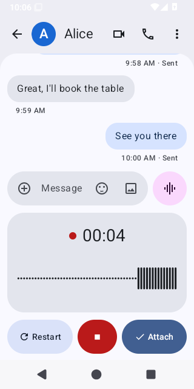](docs/screenshots/voice.png) |

| Link preview | Incoming call | Notification |
|---|---|---|
| [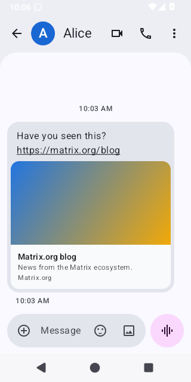](docs/screenshots/link-preview.png) | [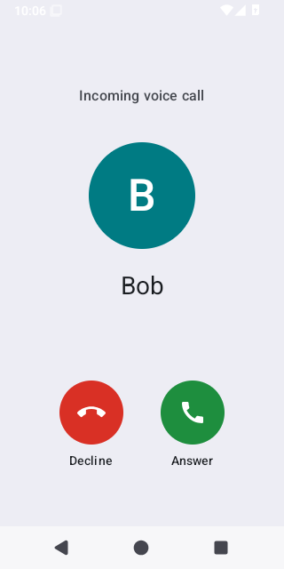](docs/screenshots/incoming-call.png) | [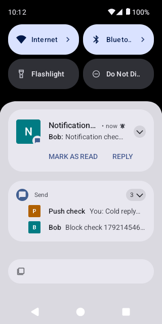](docs/screenshots/notification.png) |

| Select conversations | Device verification | Settings |
|---|---|---|
| [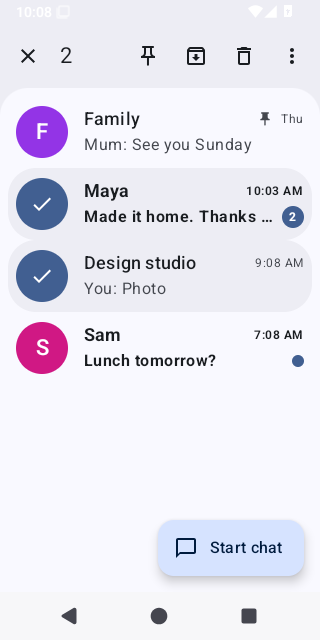](docs/screenshots/selection.png) | [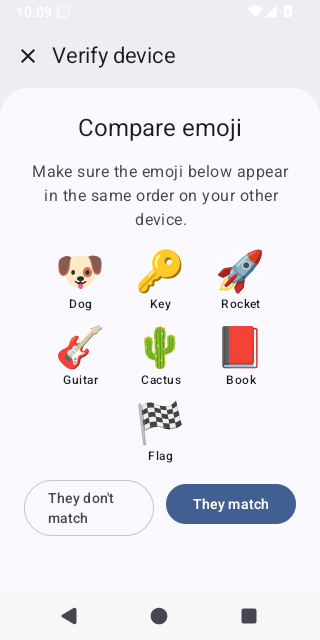](docs/screenshots/verification.png) | [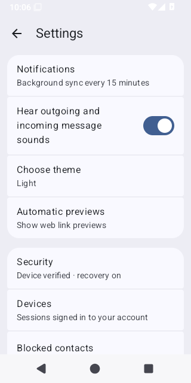](docs/screenshots/settings.png) |

| Welcome | Sign in | Dark theme |
|---|---|---|
|  |  | [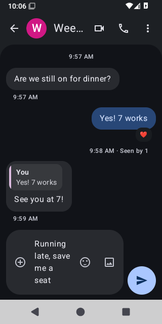](docs/screenshots/dark.png) |

[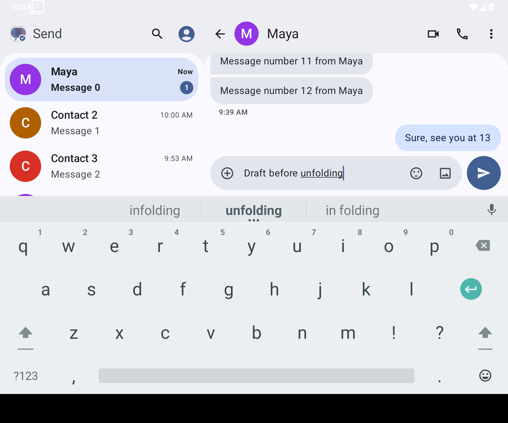](docs/screenshots/tablet.png)

Every image is captured by CI on the Android emulator from the real app — no
mockups. Each green run uploads the full set as the `Send-UI-Screenshots`
artifact; [the walkthrough](docs/SCREENSHOT_WALKTHROUGH.md) explains them.

## Install

Releases are published on the [Releases page](https://github.com/hanthor/send-android/releases)
with per-ABI APKs (arm64-v8a for most phones), an AAB and SHA-256 sums.
Builds signed with a key labelled `UNOFFICIAL-ci-signed` are test builds only.

## Build and verify

Everything is built and tested in GitHub Actions:

- **[Android CI](.github/workflows/android.yml)** — assemble, unit tests, lint,
  then the full instrumentation suite on an emulator against a disposable
  Synapse with LiveKit/MatrixRTC (two test users, real encryption, calls,
  notifications, push registration, recovery and verification).
- **[Release](.github/workflows/release.yml)** — on a `v*` tag: R8-shrunk
  per-ABI APKs and AAB, the full suite run on a minified build, then a GitHub
  Release with the mapping file.
- **[Google Messages comparison](.github/workflows/messages-comparison.yml)** —
  drives Google Messages and Send on the same emulator and reports side-by-side
  screenshots and measured differences.

## Docs

- [ROADMAP.md](ROADMAP.md) — what's done, phase by phase, with the CI runs that verify it.
- [IMPLEMENTATION_STATUS.md](IMPLEMENTATION_STATUS.md) — implemented paths and known limits.
- [DEVELOPMENT.md](DEVELOPMENT.md) — local Synapse/MatrixRTC backend and comparison tooling.
- [ANDROID_INTEGRATIONS.md](ANDROID_INTEGRATIONS.md) — Android surfaces still to come (bubbles, widgets, Android Auto).
- [PRIVACY.md](PRIVACY.md) — what leaves the device and why; also shown in the app under About.
- [docs/accessibility.md](docs/accessibility.md) — accessibility checks and contrast ratios.
- [fastlane/metadata/android/en-US](fastlane/metadata/android/en-US) — store listing for F-Droid and Google Play.

## License

Send is licensed under the **GNU Affero General Public License v3.0 only**
(`AGPL-3.0-only`). See [LICENSE](LICENSE) for the full text.

The app links Element Call Android and the Matrix Rust RTC core, which are
dual-licensed `AGPL-3.0-only OR LicenseRef-Element-Commercial` by Element
Creations Ltd.; Send is distributed under the AGPL-3.0-only option. This
repository is the Corresponding Source for distributed builds. Other bundled
libraries are listed in
[app/src/main/assets/THIRD_PARTY_NOTICES.txt](app/src/main/assets/THIRD_PARTY_NOTICES.txt)
and in the app under About & licenses.
