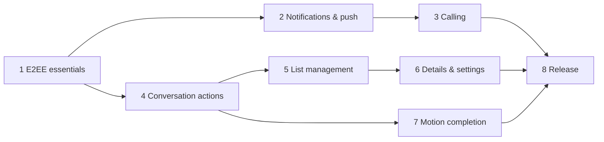

# Send roadmap to completion

Baseline: Google Messages `20260924` compared on the same emulator
(`Google Messages comparison` workflow) plus its recovered motion specs
(`Google Messages motion specs` workflow). Assessed 2026-10-15.

## Where we are

| Area | Parity | Done | Missing |
|---|---|---|---|
| Core screen styling | ~90% | Home top bar + sheet, rows, avatars, palette, conversation header, bubbles, composer, New chat, in-app media viewer; back/call buttons and composer field measure identical dp | Conversation details page, settings screens |
| Messaging actions | ~85% | Text, photo/video/file, voice (hold-to-record + slide-up lock), reactions (quick row + full picker), pagination, local echo + Sending/Sent/Not sent, mark-as-read, long-press actions (reply/copy/edit/forward/delete/info), swipe-to-reply with quotes, "Edited"/"Message deleted", typing dots, "Read"/"Seen by N", link previews, full emoji picker, in-conversation search | GIF/sticker picker, scheduled send, starred messages, auto-pagination on scroll |
| Conversation list | ~40% | Search, snippet, relative time, unread badge, groups, mute (⋮ menu + muted icon) | Archive, pin, swipe actions, multi-select, block/spam, leave |
| Motion | ~50% | Screen open/close transitions, M3 spring tokens, expand/collapse springs, swipe-to-reply spring with haptic threshold, voice-lock slide | FAB collapse on scroll, list item animations, predictive back, shared-element avatar, bubble entry, list swipe actions |
| System integration | ~45% | MessagingStyle notifications, UnifiedPush pusher + background-sync fallback, inline reply, mark read, long-lived conversation shortcuts, notification deep links | Share target, bubbles, widgets, Android Auto, FCM |
| Calling | ~65% | Outgoing/incoming 1:1 and group calls via Element Call, full-screen CallStyle ring with answer/decline, decline both ways, voice/video buttons, call rows in the timeline, join banner + list icon, mute/routing, PiP | Core-Telecom, missed-call notification, media verified in CI, group call notices, Element Call out of rc |
| Account & E2EE safety | ~85% | Password/QR/SSO login, well-known discovery, session restore, Keystore-wrapped store, sign-out with store wipe, cross-signing bootstrap, recovery/key backup setup and restore, SAS emoji verification, unverified-session banner, "Waiting for this message…" bubbles | Change/reset recovery key, reset identity when no verified device or key is left, session list (other devices) |

Overall: **looks ~85–90% like Messages, behaves ~65% like it** (phases 1–4 done; list management, details/settings and motion remain).

## Phases

Each phase ships through PRs with Android CI green; anything CI's emulator
cannot drive is called out and verified on a device.

### 1. E2EE account essentials (blocks everything) — done
Verified by Android CI runs [38710089747](https://github.com/hanthor/send-android/actions/runs/38710089747) and [38711983718](https://github.com/hanthor/send-android/actions/runs/38711983718) (`ZZAccountSecurityIntegrationTest`, `SecurityUiTest`).
- [x] Logout (SDK logout + local store wipe).
- [x] Device verification (SAS emoji) and cross-signing bootstrap.
- [x] Key backup + recovery key setup/restore; clear "can't decrypt" bubbles with recovery prompt.
- [x] *Acceptance:* a second Alice device verifies, restores history from backup, and decrypts in CI.
- Not end to end in CI: the app as the *requesting* side of SAS ("Verify this device"); CI drives that side with a second SDK client and the app accepts. Fixtures cover the app's screens for it.

### 2. Notifications & push — done
Verified by Android CI run [38728600110](https://github.com/hanthor/send-android/actions/runs/38728600110) (`ZZNotificationsIntegrationTest`, `NotificationsUiTest`).
- [x] Pusher via `Client.setPusher` (UnifiedPush first, gateway discovery, `deletePusher` on unregister/sign-out); WorkManager background sync when no distributor is registered. FCM not added (no Firebase project).
- [x] Sync notification handler + `NotificationClient` decrypt events → `MessagingStyle` notifications (Person avatars, group titles, private lock-screen version) with inline reply and mark-read, long-lived conversation shortcuts with `LocusId`, tap-to-open, per-room mute (`RoomNotificationMode.MUTE` / `unmuteRoom`).
- [x] *Acceptance:* with the activity in the background, Bob's message produces a decrypted notification; after simulated process death a pushed event is decrypted with `NotificationClient`; inline reply lands encrypted on Bob's client, mark-read clears the unread count, mute silences and unmute restores.
- [x] Phase 3 hook: `m.rtc.notification` events reach `IncomingCalls.onIncomingCall` (no UI yet).
- Not end to end in CI: delivery through a real UnifiedPush distributor (no distributor app on the emulator, and Synapse in Docker can't reach a gateway on it); CI checks the endpoint→pusher mapping in Synapse and the pushed-event path separately. Real process death (CI simulates it in-process), Doze/frozen-app timing of the 15-minute background sync, and the system Conversations section/permission dialog are left to device testing.

### 3. Calling (Messages-style) — done (media left to device testing)
Verified by Android CI run [38739979359](https://github.com/hanthor/send-android/actions/runs/38739979359) (`ZZRtcCallsIntegrationTest`, `CallUiTest`).
- [x] CI MatrixRTC backend: LiveKit + lk-jwt-service in `dev/matrix/compose.yaml`, Synapse MSC4143 transport discovery and MSC4140 delayed events, `check-rtc.sh` walks the token chain; Alice's client discovers the LiveKit transport.
- [x] Incoming: `RtcNotificationType.RING` (via phase 2) → full-screen `CallStyle` notification on a "Calls" channel (ringtone, insistent, expiry timeout) + Messages-style ringing screen over the lock screen; answer joins the room's MatrixRTC session through Element Call (no re-ring of the caller), decline sends `Room.declineCall`; `CallDeclineListener` / call membership stop ringing on other devices.
- [x] Outgoing: Element Call rings the other side of a DM; "Calling…" while it rings; the other side's decline ends the call with "Call declined".
- [x] Video calls (camera permission on demand by Element Call); header has Video call and Voice call buttons.
- [x] Call events in the timeline ("Missed voice call", "Voice call · 2:31", "Call declined", "… in progress" with Join, Call back).
- [x] Group calls: call icon in the list, "Voice call in progress · N people" banner with Join; new groups let every member join calls.
- [x] *Acceptance:* Bob rings Alice in CI, Alice's device shows the CallStyle ring, decline reaches Bob, answer puts Alice's membership in Bob's session, Alice's call rings Bob and his decline ends it.
- Not in CI: media (Alice's call stays in `ConnectingMedia` against Bob's SDK-only membership; nobody publishes media, and the RTC core's logs are off), lock-screen/full-screen display (CI's screen is on and unlocked, so the ring is a heads-up), ringtone/vibration. AndroidX Core-Telecom isn't used: Element Call owns call audio (its own audio-device controller, focus and microphone/camera foreground service), which a self-managed Telecom call would also claim. Track Element Call out of release-candidate; re-pin when stable.

### 4. Conversation behaviour parity — done
Verified by Android CI run [38758467321](https://github.com/hanthor/send-android/actions/runs/38758467321) (`ZZConversationActionsIntegrationTest`, `ConversationActionsUiTest`).
- [x] Long-press: Messages' dimmed overlay with the bubble kept visible, a quick-reaction pill above it (+ full picker for more reactions) and a rounded action menu below it (Reply, Forward, Copy, Edit for own text, Delete for own with confirm, Info).
- [x] Swipe a bubble right to reply (resistance, haptic tick at the threshold, `SendMotion` spring back); "Replying to …" strip above the composer; sent replies (`Timeline.sendReply`) quote the original inside the bubble and tapping the quote scrolls to it, paginating back until it is loaded.
- [x] Edit (`Timeline.edit` with `EditedContent.RoomMessage`) in the composer with an "Editing message" strip; edited messages say "Edited". Delete for everyone (`Timeline.redactEvent`) renders a muted "Message deleted" bubble.
- [x] Forward: conversation picker built from the list rows (encrypted rooms only); the copy is sent with `contentWithoutRelationFromMessage` (media re-uses the original encrypted upload) and that conversation opens.
- [x] Typing: `Room.typingNotice` follows the draft; `subscribeToTypingNotifications` shows Messages' three-dot bubble.
- [x] Read receipts from the timeline (`EventTimelineItem.readReceipts`): "Read" (DMs) / "Seen by N" (groups) under the newest own message; Info lists who read it and when.
- [x] Links are tappable (`Linkify` web URLs); `Client.getUrlPreview` OpenGraph data becomes a preview card (image, title, description, site); no card when the homeserver has none.
- [x] In-app media viewer: pinch/double-tap zoom for photos, `VideoView` playback with controls, Share and Save (MediaStore).
- [x] Full emoji picker (categories, recents, skin tones, offline search by Unicode name) for the composer and reactions.
- [x] In-conversation search (⋮ → Search) over the loaded timeline with highlighted matches, "n of m" and older/newer jumps; stepping past the oldest match loads older history.
- [x] Voice recording lock: slide up while holding to keep recording hands-free in Messages' panel (red dot + timer, live level line, Restart / red Stop pill / Attach); after stopping the pill plays the clip back, Attach puts it in the composer to send, or delete.
- [x] *Acceptance:* in CI Alice swipes to reply and Bob's client gets the in-reply-to relation; Alice's edit replaces the text on Bob's client; her delete reaches Bob as a redaction; Bob's typing shows the dots and Alice's draft reaches Bob's typing listener; Bob's read receipt turns "Sent" into "Read"; forwarding Bob's message into a second room delivers it there.
- Not in CI: link previews against a real page (the CI homeserver has URL previews off; CI checks that nothing is shown then, and fixtures cover the card), recording from a real microphone (the emulator has no audio input; the lock gesture runs against a stand-in recorder), and video playback in the viewer. Search uses the loaded timeline, not the SDK's `SearchService` (a client-wide index of its own); older history is loaded on demand.

### 5. Conversation list management
- Archive (low-priority tag), pin (favourite), mute, swipe actions, long-press multi-select bar, block (`ignoreUser`), leave/delete.

### 6. Details & settings
- Conversation details (people, notifications, media, block/leave), profile, settings (theme, notifications, privacy, about/licences).

### 7. Motion completion
- Extended FAB collapses to icon on scroll (Messages ships `m3_extended_fab_change_size_*` specs), `animateItem` list placement, predictive back, shared-element avatar into conversation, bubble entry.
- Verify on a physical device: the CI emulator records ~10 fps, too coarse for timing.

### 8. Release
- Release build with R8, signing, F-Droid/Play metadata, privacy policy.
- Accessibility (TalkBack, font scale), tablets/foldables, dark-theme pass.
- System surfaces from `ANDROID_INTEGRATIONS.md` (share target, bubbles, widgets, Android Auto).

## Order and dependencies

