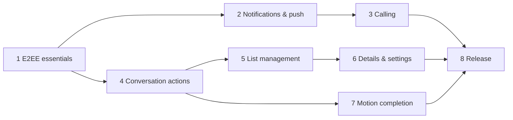

# Send roadmap to completion

Baseline: Google Messages `20260924` compared on the same emulator
(`Google Messages comparison` workflow) plus its recovered motion specs
(`Google Messages motion specs` workflow). Assessed 2026-10-15.

## Where we are

| Area | Parity | Done | Missing |
|---|---|---|---|
| Core screen styling | ~92% | Home top bar + sheet, rows, avatars (real room/member pictures), palette, conversation header, bubbles, composer, New chat, in-app media viewer, conversation Details, Settings (Messages' segmented list), profile; back/call buttons and composer field measure identical dp | Details people card and media grid density differ from Messages |
| Messaging actions | ~90% | Text, photo/video/file, voice (hold-to-record + slide-up lock), reactions (quick row + full picker), pagination, local echo + Sending/Sent/Not sent, mark-as-read, long-press actions (reply/copy/edit/forward/delete/star/select more/info), multi-select copy/forward/delete, starred messages (account data), swipe-to-reply with quotes, "Edited"/"Message deleted", typing dots, "Read"/"Seen by N", link previews, full emoji picker, GIF and sticker tabs (MSC2545 image packs: user/room/enabled packs, add from photos, m.sticker rendering, animated pictures), in-conversation search, older history loaded on scroll with a spinner and a jump-to-newest button counting new messages | scheduled send |
| Conversation list | ~85% | Search, snippet, relative time, unread badge, groups, mute, swipe to archive with Undo, Archived screen, pin to top, long-press multi-select bar (pin/archive/delete/mute/read-unread/block/report spam), delete (leave + forget), block + Spam & blocked, Settings → Swipe actions (archive / delete / mark read-unread / none per direction) | Trash |
| Motion | ~85% | Screen open/close transitions, M3 spring tokens, expand/collapse springs, swipe-to-reply and swipe-to-archive on shared spring + threshold haptics, voice-lock slide, `animateItem` placement in the list and timeline, extended FAB collapse on scroll (MDC change-size spec), predictive back with gesture-driven scale, shared-element avatar/name into the conversation, bubble entry (own rise, incoming fade+grow), CI jank guard | Timing judged on a physical device (CI emulator renders in software at ~10 fps recording); predictive back reveals the surface, not the previous screen, during the gesture |
| System integration | ~60% | MessagingStyle notifications, UnifiedPush pusher + background-sync fallback, inline reply, mark read, long-lived conversation shortcuts, notification deep links, share target (text/photos/files, encrypted rooms only, confirmation) with direct-share conversation shortcuts, list-detail on tablets/unfolded foldables | Bubbles, widgets, Android Auto, FCM |
| Calling | ~65% | Outgoing/incoming 1:1 and group calls via Element Call, full-screen CallStyle ring with answer/decline, decline both ways, voice/video buttons, call rows in the timeline, missed-call notification with Call back / Message, join banner + list icon, mute/routing, PiP | Core-Telecom, media verified in CI, group call notices, Element Call out of rc |
| Account & E2EE safety | ~90% | Password/QR/SSO login, well-known discovery, session restore, SDK store encrypted with a Keystore-wrapped key, sign-out with store wipe, cross-signing bootstrap, recovery/key backup setup and restore, SAS emoji verification, unverified-session banner, "Waiting for this message…" bubbles, session list with password-confirmed sign-out of other devices, DM partner identity state | Change/reset recovery key, reset identity when no verified device or key is left, verifying other users |

Overall: **looks ~90% like Messages, behaves ~85% like it** (phases 1–8 done; `v0.1.0-rc.2` is the latest release candidate, signed with a throwaway CI key until the owner adds the release key — see phase 8).

## Phases

Each phase ships through PRs with Android CI green; anything CI's emulator
cannot drive is called out and verified on a device.

### 1. E2EE account essentials (blocks everything) — done
Verified by Android CI runs [38710089747](https://github.com/hanthor/send-android/actions/runs/38710089747) and [38711983718](https://github.com/hanthor/send-android/actions/runs/38711983718) (`ZZAccountSecurityIntegrationTest`, `SecurityUiTest`).
- [x] Logout (SDK logout + local store wipe).
- [x] Device verification (SAS emoji) and cross-signing bootstrap.
- [x] Key backup + recovery key setup/restore; clear "can't decrypt" bubbles with recovery prompt.
- [x] *Acceptance:* a second Alice device verifies, restores history from backup, and decrypts in CI.
- Not end to end in CI: the app as the *requesting* side of SAS ("Verify this device"); CI drives that side with a second SDK client and the app accepts. Fixtures cover the app's screens for it.

### 2. Notifications & push — done
Verified by Android CI run [38728600110](https://github.com/hanthor/send-android/actions/runs/38728600110) (`ZZNotificationsIntegrationTest`, `NotificationsUiTest`).
- [x] Pusher via `Client.setPusher` (UnifiedPush first, gateway discovery, `deletePusher` on unregister/sign-out); WorkManager background sync when no distributor is registered. FCM not added (no Firebase project).
- [x] Sync notification handler + `NotificationClient` decrypt events → `MessagingStyle` notifications (Person avatars, group titles, private lock-screen version) with inline reply and mark-read, long-lived conversation shortcuts with `LocusId`, tap-to-open, per-room mute (`RoomNotificationMode.MUTE` / `unmuteRoom`).
- [x] *Acceptance:* with the activity in the background, Bob's message produces a decrypted notification; after simulated process death a pushed event is decrypted with `NotificationClient`; inline reply lands encrypted on Bob's client, mark-read clears the unread count, mute silences and unmute restores.
- [x] Phase 3 hook: `m.rtc.notification` events reach `IncomingCalls.onIncomingCall` (no UI yet).
- Not end to end in CI: delivery through a real UnifiedPush distributor (no distributor app on the emulator, and Synapse in Docker can't reach a gateway on it); CI checks the endpoint→pusher mapping in Synapse and the pushed-event path separately. Real process death (CI simulates it in-process), Doze/frozen-app timing of the 15-minute background sync, and the system Conversations section/permission dialog are left to device testing.

### 3. Calling (Messages-style) — done (media left to device testing)
Verified by Android CI run [38739979359](https://github.com/hanthor/send-android/actions/runs/38739979359) (`ZZRtcCallsIntegrationTest`, `CallUiTest`).
- [x] CI MatrixRTC backend: LiveKit + lk-jwt-service in `dev/matrix/compose.yaml`, Synapse MSC4143 transport discovery and MSC4140 delayed events, `check-rtc.sh` walks the token chain; Alice's client discovers the LiveKit transport.
- [x] Incoming: `RtcNotificationType.RING` (via phase 2) → full-screen `CallStyle` notification on a "Calls" channel (ringtone, insistent, expiry timeout) + Messages-style ringing screen over the lock screen; answer joins the room's MatrixRTC session through Element Call (no re-ring of the caller), decline sends `Room.declineCall`; `CallDeclineListener` / call membership stop ringing on other devices.
- [x] Outgoing: Element Call rings the other side of a DM; "Calling…" while it rings; the other side's decline ends the call with "Call declined".
- [x] Video calls (camera permission on demand by Element Call); header has Video call and Voice call buttons.
- [x] Call events in the timeline ("Missed voice call", "Voice call · 2:31", "Call declined", "… in progress" with Join, Call back).
- [x] Group calls: call icon in the list, "Voice call in progress · N people" banner with Join; new groups let every member join calls.
- [x] *Acceptance:* Bob rings Alice in CI, Alice's device shows the CallStyle ring, decline reaches Bob, answer puts Alice's membership in Bob's session, Alice's call rings Bob and his decline ends it.
- Not in CI: media (Alice's call stays in `ConnectingMedia` against Bob's SDK-only membership; nobody publishes media, and the RTC core's logs are off), lock-screen/full-screen display (CI's screen is on and unlocked, so the ring is a heads-up), ringtone/vibration. AndroidX Core-Telecom isn't used: Element Call owns call audio (its own audio-device controller, focus and microphone/camera foreground service), which a self-managed Telecom call would also claim. Track Element Call out of release-candidate; re-pin when stable.

### 4. Conversation behaviour parity — done
Verified by Android CI run [38758467321](https://github.com/hanthor/send-android/actions/runs/38758467321) (`ZZConversationActionsIntegrationTest`, `ConversationActionsUiTest`).
- [x] Long-press: Messages' dimmed overlay with the bubble kept visible, a quick-reaction pill above it (+ full picker for more reactions) and a rounded action menu below it (Reply, Forward, Copy, Edit for own text, Delete for own with confirm, Info).
- [x] Swipe a bubble right to reply (resistance, haptic tick at the threshold, `SendMotion` spring back); "Replying to …" strip above the composer; sent replies (`Timeline.sendReply`) quote the original inside the bubble and tapping the quote scrolls to it, paginating back until it is loaded.
- [x] Edit (`Timeline.edit` with `EditedContent.RoomMessage`) in the composer with an "Editing message" strip; edited messages say "Edited". Delete for everyone (`Timeline.redactEvent`) renders a muted "Message deleted" bubble.
- [x] Forward: conversation picker built from the list rows (encrypted rooms only); the copy is sent with `contentWithoutRelationFromMessage` (media re-uses the original encrypted upload) and that conversation opens.
- [x] Typing: `Room.typingNotice` follows the draft; `subscribeToTypingNotifications` shows Messages' three-dot bubble.
- [x] Read receipts from the timeline (`EventTimelineItem.readReceipts`): "Read" (DMs) / "Seen by N" (groups) under the newest own message; Info lists who read it and when.
- [x] Links are tappable (`Linkify` web URLs); `Client.getUrlPreview` OpenGraph data becomes a preview card (image, title, description, site); no card when the homeserver has none.
- [x] In-app media viewer: pinch/double-tap zoom for photos, `VideoView` playback with controls, Share and Save (MediaStore).
- [x] Full emoji picker (categories, recents, skin tones, offline search by Unicode name) for the composer and reactions.
- [x] In-conversation search (⋮ → Search) over the loaded timeline with highlighted matches, "n of m" and older/newer jumps; stepping past the oldest match loads older history.
- [x] Voice recording lock: slide up while holding to keep recording hands-free; Messages' recorder opens below the composer (00:00 timer with red dot, dotted live level line, then Restart / red Stop / Attach pills); after stopping the red pill plays the clip back, Attach puts it in the composer to send or delete, and the round button closes the recorder.
- [x] *Acceptance:* in CI Alice swipes to reply and Bob's client gets the in-reply-to relation; Alice's edit replaces the text on Bob's client; her delete reaches Bob as a redaction; Bob's typing shows the dots and Alice's draft reaches Bob's typing listener; Bob's read receipt turns "Sent" into "Read"; forwarding Bob's message into a second room delivers it there.
- Not in CI: link previews against a real page (the CI homeserver has URL previews off; CI checks that nothing is shown then, and fixtures cover the card), recording from a real microphone (the emulator has no audio input; the lock gesture runs against a stand-in recorder), and video playback in the viewer. Search uses the loaded timeline, not the SDK's `SearchService` (a client-wide index of its own); older history is loaded on demand.

### 5. Conversation list management — done
Verified by Android CI run [38801026895](https://github.com/hanthor/send-android/actions/runs/38801026895) (`ZZListManagementIntegrationTest`, `ListManagementUiTest`).
- [x] Archive: swipe a row either way (the row lifts onto a grey pill over Messages' primary-blue track — not green, per the Messages capture — with the archive glyph growing in, haptic tick at the threshold, `SendMotion` spring off-screen or back) or Archive in the selection bar sets the room's `m.lowpriority` tag (`Room.setIsLowPriority`); "1 conversation archived" snackbar with Undo (which also re-pins). Archived rooms stay archived when new messages arrive and still notify unless muted. Account menu → Archived lists them (swipe or select to unarchive, tap to open).
- [x] Long-press a row → Messages' contextual bar with multi-select: count, Pin/Unpin (`m.favourite` via `Room.setIsFavourite`; pinned rows sort first with a pin icon), Archive, Delete, and ⋮ Mute/Unmute (push rule), Mark as read/unread (`Room.setUnreadFlag` + read receipt; marked-unread rows are bold with a dot), Block (one DM). Selected rows show a check mark in place of the avatar.
- [x] Delete: confirm, then leave + forget (`Room.leave` / `Room.forget`) — gone from every device's list.
- [x] Block: confirm dialog explains it; `Client.ignoreUser` puts the DM's other person in `m.ignored_user_list` and their DMs leave the list; account menu → Spam & blocked unblocks (`unignoreUser`), live via `subscribeToIgnoredUsers`.
- [x] Star messages: long-press → Star/Unstar, stored as `dev.send.starred` account data (room → event IDs) so every session sees it; starred bubbles show a star; conversation ⋮ → Starred lists them (`Room.loadOrFetchEvent` for ones not loaded) and jumps to them. Long-press → Select more: multi-select with Copy (joined in thread order), Forward (all to one conversation) and Delete (own only, confirmed).
- [x] Changes show at once (pending tag/flag/removal overlay in the repository until sync echoes them, 60 s cap).
- [x] *Acceptance:* `ZZListManagementIntegrationTest` checks each change on Synapse's REST API (a probe device reading Alice's tags and account data) and in Alice's synced client state: swipe archive puts `m.lowpriority` on the server and in `RoomInfo` and Bob's new message keeps it; Archived → swipe removes it on both; Pin sets `m.favourite` and the row sorts first; Mark as unread sets `m.marked_unread` (`unread: true`) and the dot, Mark as read sets it false; Delete leaves (gone from Synapse's `joined_rooms`, Bob sees one member) and forgets; Block puts Bob in `m.ignored_user_list` and his DMs leave the list, Spam & blocked → Unblock removes him; the star lands in `dev.send.starred` on the server, comes back through sync and survives a cold `restore()`. `ListManagementUiTest` fixtures + audit shots for each surface.
- Not built: configurable swipe actions (Messages' settings; default archive only), Snooze and Add contact (no Matrix equivalent), spam reporting, Messages' Trash. Room account data has no FFI setter, so stars live in global account data keyed by room rather than per-room account data.
- Visual gaps from the comparison (run [38791048334](https://github.com/hanthor/send-android/actions/runs/38791048334)): Messages marks multi-selected messages with a check circle beside each bubble and has no Forward in that bar; Send tints the selected rows and offers Forward. Messages' starred list wasn't reachable on the SMS emulator (no Starred entry found), so there is no reference for it. Send's mid-swipe shot is blank on the comparison emulator (SwANGLE), though correct in Android CI's screenshots.

### 6. Details & settings — done
Verified by Android CI run [38820666393](https://github.com/hanthor/send-android/actions/runs/38820666393) on main (`ZZDetailsSettingsIntegrationTest`, `DetailsSettingsUiTest`).
- [x] Conversation details (⋮ → Details or tap the header): large avatar and name, Voice call / Video call / Search / Mute pills, Notifications level (All messages / Mentions only / Off as room push rules), group name / description / photo when power levels allow, People with avatars and roles (profile sheet with Message / Block), Add people (invite by Matrix ID when allowed), Media & files strip + grid with real thumbnails, Starred messages, "End-to-end encrypted" with the DM partner's identity state, Archive / Block / Delete conversation / Leave group.
- [x] Profile (account card): display name, photo upload/remove, Matrix ID with copy.
- [x] Settings like Messages settings: Notifications (system page link + delivery method), outgoing/incoming message sounds (implemented), Choose theme (Light / Dark / System default, wired to `SendTheme` and the system bars), Automatic previews page (link previews on/off), Security, Devices (sign out other sessions with the password), Spam & blocked, Archived, About & licenses. Bubbles and Suggestions are not offered (not implemented).
- [x] *Acceptance:* in CI Alice renames a group and sets its topic and Bob's client shows both; she invites Carol (invite membership on Synapse); Mentions only / Off / All messages land as the room's push rules on Synapse and read back in Details; her new display name reaches Bob's client; Settings → Devices signs a REST probe session out with her password and Synapse drops the device and its token.
- Not end to end in CI: group/profile photo upload (no picker on the CI emulator; fixtures cover the screens), the browser-based sign-out confirmation (Synapse asks for the password), OAuth account-page sign-out, and the sounds' audio output (the emulator has no audio device; a fixture checks they fire).
- The FFI has no device list or delete call; Devices uses the client-server API (`/devices`, `/delete_devices`) with the session's token.
- Visual comparison (run [38820713647](https://github.com/hanthor/send-android/actions/runs/38820713647)): Details matches Messages' layout — back arrow only, 96dp avatar, large name, equal tonal pill actions with labels, icon rows on rounded tiles, red destructive rows. Differences: Send has four actions (Voice call, Video call, Search, Mute) where Messages has Call / Add contact / Search, shows the Matrix ID or member count under the name, groups related rows on one tile, and lists people under a "People" label rather than Messages' "N other person · Create group" card; Messages' Starred row carries a count and chevron. Media & files is a 3-column rounded grid with gaps; Messages uses a 4-column edge-to-edge grid under a search pill. Settings matches the segmented tiles and title bar; the theme dialog (Light / Dark / System default, Cancel / OK) and the Automatic previews page follow Messages. Messages' Notifications row opens the system channel page; Send's per-conversation levels are Matrix push rules, so it keeps its own dialog. Messages' participant row opens nothing on the SMS emulator, so the profile sheet has no reference.

### 7. Motion completion — done
Verified by Android CI run [38833004190](https://github.com/hanthor/send-android/actions/runs/38833004190) on main and PR run [38831588979](https://github.com/hanthor/send-android/actions/runs/38831588979) (`MotionUiTest`, `MotionJankTest`).
- [x] Extended FAB "Start chat" collapses to its icon scrolling down and expands scrolling up or at the top, on MDC's public `m3_extended_fab_change_size_{collapse,expand}_motion_spec` values (400ms emphasized size change; label out 50→150ms, in 100→300ms).
- [x] `animateItem` placement on SendMotion springs for conversation rows (pin, archive, new message reorder), Archived/Blocked/Starred rows and timeline items; timeline rows keyed by the SDK's stable item ID so local echoes keep their row.
- [x] Bubble entry: own bubbles rise from the composer (spatial spring + fade), incoming fade and grow; history doesn't animate.
- [x] Predictive back (`enableOnBackInvokedCallback`, `PredictiveBackHandler`): conversation → list and Details / Media & files / Starred / Archived / Blocked / Settings pages → previous scale to 90% and shift with the gesture, spring back on cancel, leave with the SendMotion close transition on release.
- [x] Shared-element avatar (and name, cross-faded bounds) from the list row into the conversation header and back, including after a predictive back release.
- [x] Swipe-to-reply and swipe-to-archive share one spring token and threshold haptics (activate/deactivate pair).
- [x] *Acceptance:* fixtures on the paused Compose clock: the FAB is mid-collapse ~130ms after a scroll, collapsed to 56dp after it, re-expanded scrolling up and at the top; the shared transition is active 100ms into opening and into back and done after; back progress 0.5 scales the conversation to 95% (1.0 → 90%), cancel restores it, release returns to the list; a new own bubble is 10–90% of its 64dp rise at ~50ms and an incoming one between 82% and 99% scale. `MotionJankTest` drives real input (16 flings over 200 rows, 3 conversation open/close with animations on) and reads `dumpsys gfxinfo framestats`: on main 20 janky of 461 frames (4.3%; p50 19ms, p90 30ms, p95 36ms, p99 77ms), on the PR 24 of 450 (5.3%; p99 109ms); it fails above 15%.
- Honest limit: visual timing and feel are still best judged on a physical device. The CI emulator renders with swiftshader (half its frames take >16ms whatever the app does) and records at ~10 fps, so the jank guard catches regressions rather than certifying smoothness; the paused-clock tests prove states at given times, not how they look.

### 8. Release — done (owner signing and store accounts pending)
Verified by Android CI run [38860585447](https://github.com/hanthor/send-android/actions/runs/38860585447) on main (95 tests), release runs [38845809643](https://github.com/hanthor/send-android/actions/runs/38845809643) (`v0.1.0-rc.1`) and [38855520936](https://github.com/hanthor/send-android/actions/runs/38855520936) (`v0.1.0-rc.2`), and the flake matrices below.
- [x] **Stability first.** A temporary 5-leg `workflow_dispatch`/branch matrix (never merged; `flake/*` branches deleted) measured the suite before and after. Before, on main `5e4c34b` (runs [38837668055](https://github.com/hanthor/send-android/actions/runs/38837668055), [38837680254](https://github.com/hanthor/send-android/actions/runs/38837680254) + Android CI [38837668028](https://github.com/hanthor/send-android/actions/runs/38837668028), [38837680255](https://github.com/hanthor/send-android/actions/runs/38837680255)): **4 of 12 suite runs failed** (ZLocal unread badge ×3, ZZNotifications `RoomNotJoined` ×1, ZZRtcCalls call rows ×1). After the fixes (PR #84; [38838638982](https://github.com/hanthor/send-android/actions/runs/38838638982), [38838640858](https://github.com/hanthor/send-android/actions/runs/38838640858) + 2 Android CI): **12 of 12 green**. A matrix on main with every phase-8 feature ([38854064042](https://github.com/hanthor/send-android/actions/runs/38854064042)) found one more (a new row below the fold in ZZListManagement, fixed in PR #87); the final matrix on main `eca4542` ([38860617676](https://github.com/hanthor/send-android/actions/runs/38860617676), [38860621021](https://github.com/hanthor/send-android/actions/runs/38860621021) + 2 Android CI + main [38860585447](https://github.com/hanthor/send-android/actions/runs/38860585447)): **13 of 13 green, 95 tests each**. Root causes:
  - Compose `Detected multithreaded access to SnapshotStateObserver` / `performMeasureAndLayout called during measure layout`: the v1 test rules run composition on `UnconfinedTestDispatcher`, so an effect resuming from `Dispatchers.IO` ran the Recomposer frame (`measureAndLayoutForTest`) on the IO thread while the main thread drew. All tests use the v2 rules (`StandardTestDispatcher`, driven from the main thread). Test-only; production composition runs on `AndroidUiDispatcher`.
  - Unread badge not clearing (the "60 s of SDK silence" was simply nothing left to sync): `MatrixRepository.refreshRoom` read the room summary outside the list lock, and when the receipt's sync response landed ~2 ms after the receipt request, the stale summary was published over the diff that cleared the count. It now reads under the lock (app fix; also the cause of ZZNotifications' "read receipt" timeouts).
  - `RoomNotJoined`: test Bob clients joined right after starting sync; the initial sync, computed before the join and applied after it, rolled the room back to invited. `joinWhenSynced` waits for the invite through sync, joins, and waits for JOINED.
  - ZZRtcCalls call-row count: the first ring could be older than the page loaded when Answer opened the conversation; the test loads older history (⋮ → Load older messages). ZZListManagement: a new group without a recency stamp from sync sorts after every room that has one; the test scrolls the list to rows.
  - After the final matrix, one more ZZListManagement failure showed up on a docs-only push run ([38870045640](https://github.com/hanthor/send-android/actions/runs/38870045640)): the long-press on Bob's DM row was injected just as his message re-sorted the row, and a row moving under a still pointer cancels the long press. The test now waits for idle and retries the press (PR #90). In the measured matrices after PR #84, 1 of 31 suite runs failed (the below-the-fold row, PR #87); this long-press failure came from outside the matrices.
- [x] **Store encryption fix** (found while writing the privacy policy, PR #78): `ClientBuilder.sessionPaths` replaced the keyed store builder, so the SDK store was plain SQLite; the client now uses the keyed `SqliteStoreBuilder` only, a pre-fix store is wiped on restore, and `ZZZSessionRestoreIntegrationTest` checks room names and message text aren't readable in any store file.
- [x] **Release build** (PRs #83, #86): R8 + resource shrinking with keep rules for JNA/UniFFI, the RTC core and libwebrtc JNI, and WorkManager workers (UnifiedPush, emoji2, zxing need none; R8 reported no missing classes, no `-dontwarn` added); versionName/versionCode from the tag; per-ABI APKs (arm64-v8a 40.8 MB, armeabi-v7a 36.6 MB, x86_64 44.2 MB, universal 104.3 MB; rc.1's single APK was 316 MB) and an AAB (104.7 MB). `release.yml` on a `v*` tag signs (owner secrets, or a throwaway key with `-UNOFFICIAL-ci-signed` names and a warning), verifies signatures/version/ABIs, runs the **whole instrumentation suite on a `minified` build with the release R8 rules** (88/88 on rc.2: SDK, JNA, RTC JNI and workers really ran minified), and publishes a GitHub prerelease with APKs, AAB, `mapping.txt` and SHA-256 sums.
- [x] **Store metadata and privacy** (PRs #79, #85): `fastlane/metadata/android/en-US` (title, short/full description, changelogs 10001/10002, 512px icon, feature graphic, 6 phone + 1 tablet screenshots captured in CI by `StoreScreenshotsTest`); an original adaptive launcher icon with a themed layer (there was none); `PRIVACY.md` (homeserver traffic incl. URL previews through the homeserver, well-known lookup, UnifiedPush gateway discovery and the `matrix.gateway.unifiedpush.org` fallback, MatrixRTC/LiveKit from the homeserver, SSO in a Custom Tab, no analytics/crash reporting/ads — Element Call's sources checked for telemetry too) bundled and shown in-app from About & licenses → Privacy policy.
- [x] **Third-party notices** (PR #88): `THIRD_PARTY_NOTICES.txt` now attributes all 168 resolved release-runtime artifacts and the 4 bundled native libraries (JNA under its Apache-2.0 option with libffi, Kotlin/kotlinx, libwebrtc with its component list, the Rust crates linked into the SDK and RTC libraries, AWS-LC, SQLite), with full license texts in `assets/licenses/`; Android CI fails when a resolved dependency or native library has no entry (`dev/check-notices.sh`, main run [38868095524](https://github.com/hanthor/send-android/actions/runs/38868095524)).
- [x] **Accessibility** (PR #80): labels/roles for every icon-only control, TalkBack actions for swipe/long-press gestures, ≥48dp targets, reflow at 200% font, WCAG AA for every palette pair (table in `docs/accessibility.md`; avatar fills raised from 1.55–3.69:1 to 4.65–5.42:1). `AccessibilityUiTest` renders home, conversation, composer and Settings at font scale 2 and asserts no clipping/ellipsis, 48dp targets and labels (`a11y-font200-*` shots).
- [x] **Large screens** (PR #81): list-detail at ≥600dp wide and ≥480dp tall; fold/unfold keeps conversation, draft, scroll and keyboard. `LargeScreenUiTest` drives the emulator display (`wm size`/`density`) for tablet, fold/unfold and landscape (`tablet-*`, `fold-*` shots).
- [x] **Dark theme** (PR #80): every Material token defined in both schemes (several fell back to Material purple), dark fixtures `dark-home/-conversation/-details/-settings`.
- [x] **Share target** (PR #82): `ACTION_SEND`/`SEND_MULTIPLE` text/images/files → encrypted-only picker → "Send to …?" confirmation; conversation shortcuts are direct-share targets. `ShareTargetUiTest` + `ZZShareTargetIntegrationTest` (Bob receives the shared text and image).
- Future work, documented in `ANDROID_INTEGRATIONS.md`: bubbles, widgets, Android Auto.
- Not verified in CI: TalkBack reading order and announcements, real hinge/posture, the system share sheet's Direct Share row, real-device install of the release APK, Play/F-Droid ingestion of the metadata.
- **What the owner must do to publish:** (1) create the release key offline (`keytool -genkeypair -keystore send-release.jks -storetype PKCS12 -alias send -keyalg RSA -keysize 4096 -validity 10000`) and back it up; (2) add repository secrets `SEND_KEYSTORE_BASE64` (`base64 -w0 send-release.jks`), `SEND_KEYSTORE_PASSWORD`, `SEND_KEY_ALIAS`, `SEND_KEY_PASSWORD` (all four, or the workflow fails on purpose); (3) delete the throwaway-signed `v0.1.0-rc.1`/`rc.2` releases and tags, then push a new tag (`git tag v0.1.0 origin/main && git push origin v0.1.0`); (4) Google Play: a developer account, the app `dev.send.matrix` created in Play Console, the AAB uploaded with Play App Signing (the uploaded key becomes the upload key), the privacy policy URL (`PRIVACY.md` on GitHub), Data safety form (no data collected by the developer; data sent to the user's chosen homeserver), content rating and target-audience forms; listing text/graphics are in `fastlane/` (usable with `fastlane supply`); (5) F-Droid: open a request/merge request on fdroiddata with metadata pointing at this repository and its `v*` tags (F-Droid builds from source and signs itself unless reproducible builds are set up; its build needs the Rust SDK AAR from Maven Central, which F-Droid treats as a prebuilt binary — expect review of that), plus the AGPL source link already in the app.

## Order and dependencies

