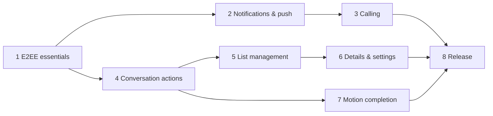

# Send roadmap to completion

Baseline: Google Messages `20260924` compared on the same emulator
(`Google Messages comparison` workflow) plus its recovered motion specs
(`Google Messages motion specs` workflow). Assessed 2026-10-15.

## Where we are

| Area | Parity | Done | Missing |
|---|---|---|---|
| Core screen styling | ~90% | Home top bar + sheet, rows, avatars, palette, conversation header, bubbles, composer, New chat; back/call buttons and composer field measure identical dp | In-app media viewer, conversation details page, settings screens |
| Messaging actions | ~40% | Text, photo/video/file, voice (hold-to-record), reactions, pagination, local echo + Sending/Sent/Not sent, mark-as-read | Reply (swipe), edit, delete, copy, forward, typing indicators, "Read" receipts, link previews, emoji/GIF picker, in-conversation search |
| Conversation list | ~35% | Search, snippet, relative time, unread badge, groups | Archive, pin, mute, swipe actions, multi-select, block/spam, leave |
| Motion | ~45% | Screen open/close transitions, M3 spring tokens, expand/collapse springs | FAB collapse on scroll, list item animations, predictive back, shared-element avatar, bubble entry, swipe gestures |
| System integration | 0% | — | Notifications, push, inline reply, shortcuts, share target, bubbles |
| Calling | ~20% | Outgoing 1:1 audio via Element Call, mute/routing, PiP, ongoing-call notification | Incoming ring, accept/decline, video, CallStyle/Telecom, call events in timeline, group calls |
| Account & E2EE safety | ~35% | Password/QR/SSO login, well-known discovery, session restore, Keystore-wrapped store | Logout, device verification, key backup / recovery key, decryption-failure UX |

Overall: **looks ~85–90% like Messages, behaves ~35–40% like it.**

## Phases

Each phase ships through PRs with Android CI green; anything CI's emulator
cannot drive is called out and verified on a device.

### 1. E2EE account essentials (blocks everything)
- Logout (SDK logout + local store wipe).
- Device verification (SAS emoji) and cross-signing bootstrap.
- Key backup + recovery key setup/restore; clear "can't decrypt" bubbles with recovery prompt.
- *Acceptance:* a second Alice device verifies, restores history from backup, and decrypts in CI.

### 2. Notifications & push
- Pusher via `Client.setPusher` (UnifiedPush first, FCM optional); background sync fallback.
- `NotificationClient` decrypts events → `MessagingStyle` notifications with inline reply and mark-read, long-lived conversation shortcuts, per-room mute (`RoomNotificationMode`).
- *Acceptance:* Bob's message produces a decrypted notification with app killed; inline reply lands encrypted.

### 3. Calling (Messages-style)
- Incoming: `RtcNotificationType` ring events (via phase 2) → full-screen `CallStyle` notification + AndroidX Core-Telecom; accept joins the room's MatrixRTC session through Element Call, decline uses `Room.declineCall`; `CallDeclineListener` stops ringing on other devices.
- Video calls (camera permission on demand), switch audio/video in call.
- Call events rendered in the timeline ("Missed call", "Call · 4:12"); call button in Messages header becomes audio/video menu.
- Group calls in group rooms (`activeRoomCallParticipants` for "join" banners).
- CI: add LiveKit + lk-jwt-service to `dev/matrix/compose.yaml` so a Bob SDK client can place/answer real calls.
- Track Element Call out of release-candidate; re-pin when stable.
- *Acceptance:* Bob rings Alice in CI, Alice's device shows the call UI, accept connects media; decline reaches Bob.

### 4. Conversation behaviour parity
- Swipe-to-reply + reply previews, edit, delete (redact), copy, forward.
- Typing indicators (`TypingNotificationsListener`) and "Read" receipts under own messages.
- Link previews, in-app photo/video viewer, full emoji picker, in-conversation search.

### 5. Conversation list management
- Archive (low-priority tag), pin (favourite), mute, swipe actions, long-press multi-select bar, block (`ignoreUser`), leave/delete.

### 6. Details & settings
- Conversation details (people, notifications, media, block/leave), profile, settings (theme, notifications, privacy, about/licences).

### 7. Motion completion
- Extended FAB collapses to icon on scroll (Messages ships `m3_extended_fab_change_size_*` specs), `animateItem` list placement, predictive back, shared-element avatar into conversation, bubble entry.
- Verify on a physical device: the CI emulator records ~10 fps, too coarse for timing.

### 8. Release
- Release build with R8, signing, F-Droid/Play metadata, privacy policy.
- Accessibility (TalkBack, font scale), tablets/foldables, dark-theme pass.
- System surfaces from `ANDROID_INTEGRATIONS.md` (share target, bubbles, widgets, Android Auto).

## Order and dependencies

