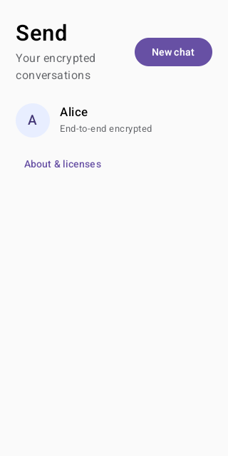
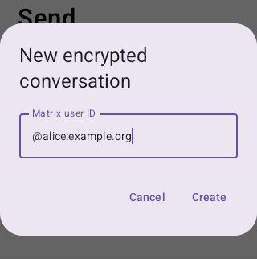
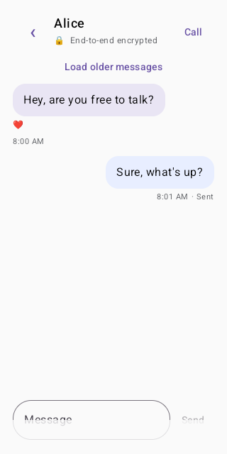

# Automated feature walkthrough

GitHub Actions provisions a fresh Synapse server, creates demo users, and runs
Send in an Android emulator. Instrumentation signs into `@alice:send.test`,
creates an encrypted direct conversation with `@bob:send.test`, sends a sample
message through the Matrix Rust SDK, and verifies it appears in the local
timeline. Screenshots are captured at native emulator resolution. Sign-in is a
static Compose fixture; the new-chat dialog, conversation list, and message
send captures are from the live app connected to Synapse.

## Screenshots

### Sign-in

### New encrypted conversation

### Conversation list

### Encrypted message send

### Conversation-list UI fixture

This static Compose fixture exercises the empty/data list presentation. Live
Synapse room creation and list appearance are shown separately above.

### New-chat dialog and recipient validation

The UI test checks that Create remains disabled without a Matrix user ID and
becomes enabled after a valid ID is entered.

### Reaction picker

The UI test long-presses a message, selects 😂, and verifies the event ID and
reaction passed to the handler.

### Conversation UI fixture

This uses sample content to verify message styling and sent state. It is a UI
fixture, not a live Matrix conversation.

## Automation coverage and limits

The UI suite verifies homeserver URL validation, new-chat recipient validation,
long-press reaction selection, legal notices, and sign-in/home/conversation
fixtures. The live Synapse walkthrough proves password authentication, encrypted
room creation, navigation, and encrypted message send/render in the local
timeline, plus delivery/decryption of that message and a 👍 reaction on Bob's
independent SDK client after Bob joins the room. It does not verify reliable
background room-list synchronization.

Synapse is not configured with MatrixRTC/LiveKit; this does not verify calls.
Push notifications, Android Auto, widgets, dictation, and AI are roadmap items,
not implemented features. CI cannot resolve `matrix.reilly.asia`, so production
SSO/login is not covered.

`UiComparisonScreenshotTest` and `LocalSynapseIntegrationTest` capture the
screenshots. GitHub Actions uploads their original PNGs as `Send-UI-Screenshots`;
the PNGs checked into this folder are taken from that artifact, not recreated
or edited from mockups.
